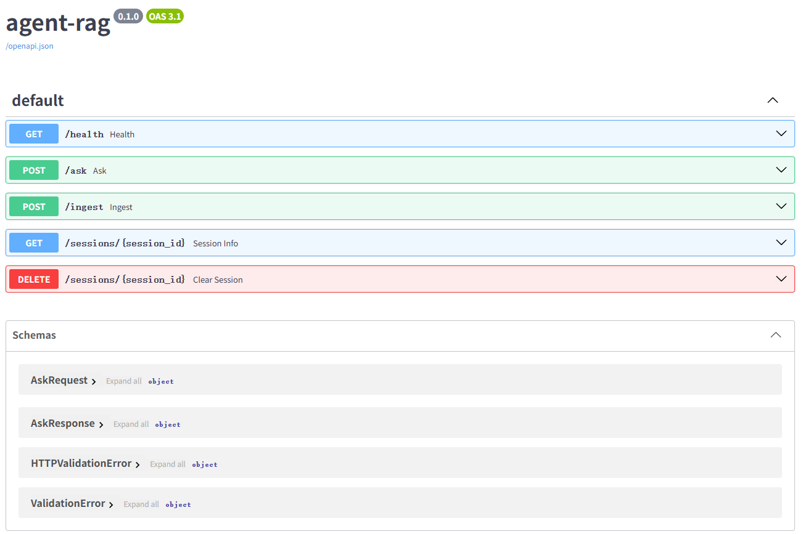
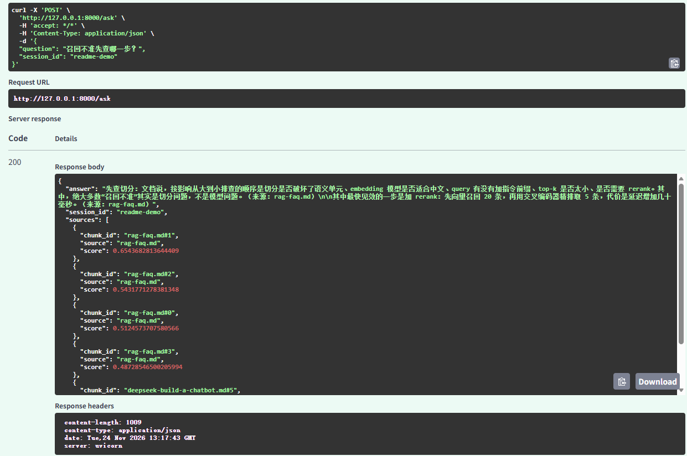
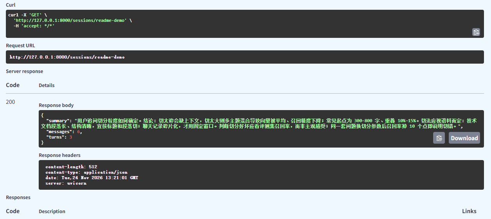

# agent-rag

基于 DeepSeek Function Calling 的文档问答 Agent：本地向量检索（bge-small-zh）+ ReAct 工具循环 + 会话记忆，配套**两层评测**（检索层 L1 / 端到端 L2）和 **before/after 对照实验**。

## 指标总表

| 指标       | 数值                                                                                                    | 出处                                                             |
| -------- | ----------------------------------------------------------------------------------------------------- | -------------------------------------------------------------- |
| 语料规模     | 31 篇 md（raw 2 + append 29），**175 块**，约 5.2 万字符                                                        | `data/index_v2.npz` vectors (175, 512)；清洗记录 `docs/corpus.md`   |
| L1 对照实验  | 语料 7 → 175 块（25 倍），对照组 Q1–Q6 Hit@1 / Recall@5 = **6/6 → 6/6，零退化**；且 top-1 分数在两套索引下逐位一致（0.5440–0.7553） | `docs/eval.md` 结果总表 + `eval/result_v1.json` / `result_v2.json` |
| L1 新语料组  | Hit@1 **1/4**，Recall@5 **3/4**（三类失败已归因，见评测一节）                                                         | 同上                                                             |
| L2 端到端   | 每个问题跑2轮，v1 组 **12/12**、v2 组 **6/8**（唯二失败为语料命名冲突 Q7 两轮）；虚构引用 **0/20**；平均步数 3.50 / 3.62                         | `eval/result_l2.json`                                          |
| 上下文缓存    | 固定前缀（system prompt + 3 个工具 schema）不变，**可缓存前缀约 640 token 恒定命中**；命中率随上下文总长浮动 39%–80%（首轮 39%，多轮升高，历史被压缩后总量变小回落到 53%） | `docs/decisions.md` 缓存条目；各轮原始 `usage` 见 `docs/eval.md` |
| 会话记忆     | 保留最近 3 轮原文（上下文注入恒为 6 条 message）+ 一条 ≤200 字摘要（temperature=0）；                               | `app/memory.py`（`KEEP_TURNS=3` / `SUMMARY_MAX_CHARS=200`）      |
| Agent 循环 | ReAct 上限 5 步，超限用强制回答收尾；(工具名, 参数) 集合去重拦截绕圈；工具返回 >2000 字符截断                         | `app/agent.py` / `app/tools/registry.py`                       |

## 架构

两条链路（完整 mermaid 图、数据形态表、失败路径表见 `docs/architecture.md`）：

- **离线**：`data/raw` + `data/append` → `ingest.py`（切分 + 编码 + 落盘 `index_v2.npz` / `chunks_v2.jsonl`）
- **在线**：`POST /ask` → `memory`（取历史/摘要）→ `agent`（ReAct 循环，调 `search_docs` / `calc` / `lookup`）→ deepseek-chat → 答案 + 来源脚注

| 组件        | 选择                                                   | 理由                                            |
| --------- | ---------------------------------------------------- | ------------------------------------------------ |
| embedding | `BAAI/bge-small-zh-v1.5`，本地 CPU，512 维，L2 归一化         | DeepSeek 无 embedding 接口；本地免费离线；单例加载防双实例          |
| 向量检索      | numpy 全量余弦（`vectors @ query`）                        | 175 块余弦实测 0.05ms，无需引入向量库                      |
| 切分        | 段落聚合 ≤450 字符 + `##` 标题断块 + <80 字短块合并，**零 overlap** | 由文档结构确定边界
| 生成        | `deepseek-chat` + Function Calling                   | Agent 一轮多次调用
| 服务        | FastAPI，路由 `def`内部阻塞调用，用线程池              | `/ask`、`/health`、`/ingest`、`/sessions/{id}` 调试接口 |


*FastAPI 自动生成的 Swagger 接口文档*


*一次问答：answer + sources + steps_count + terminated_by*


*多轮对话后，早期内容被压缩成 summary*

## 检索层

- 索引与 chunks **成对版本化**：`chunks_path_for()` 从 `index_v2.npz` 推导 `chunks_v2.jsonl`，行数不一致直接 `raise ValueError`。
- `search_docs` 返回带来源与相似度的编号列表，模型直接据此标注引用；`AGENT_INDEX` 环境变量切换被测索引。

## Agent 层（ReAct）

- 三个工具：`search_docs`（语义检索，带来源）、`calc`（字符白名单校验，拒绝裸 eval 注入）、`lookup`（按文件名取全文）。
- 兜底：检索 0 结果直接说明；工具异常作为消息回传模型可重试；达到步数上限强制收尾并声明"基于已有信息"；重复 (工具, 参数) 二次直接拦截。
- 每步落轨迹（`steps`），返回 `terminated_by: final / max_steps / error` 三态。
- system prompt 与工具 schema 内容固定，摘要作为**独立的 system 消息放在主 prompt 之后**

## 评测

- **L1 检索层**：不调用 LLM，秒级可复现，是扩语料 before/after 的主指标。
- **L2 端到端**：调用LLM，每题独立 session（答案不进上下文，测试检索而非记忆），repeat=2。
- **判定口径**：整串精确匹配 → 归一化 + `keys_all` 实体全含；"虚构引用"从"没命中 key 且带引用"改为"**引用的 .md 文件名不在本轮检索 sources 里**"。
- 对照实验结论：语料扩 25 倍对照组**命中率零退化**；但最强干扰项和正确答案得分接近，再加噪声可能无法命中。
- v2 组三个失败三种性质：Q7 ： 语料命名冲突（历史公告 和 当前最新定价页）；Q9 = 同主题竞争（rerank 靶子）；Q8 = 跨语言（中文 query → 英文文档，L1 miss）。

## 已知限制

1. 未做 rerank：最小余量 0.035，语料再增加命中率预期会下降。
2. 跨语言召回：中文 query 对英文文档 L1 失败，agent 改写可补偿但不可靠。
3. 无语料时效治理：历史公告与当前定价页命名冲突。
4. 会话历史只在进程内存，重启丢失（单机 demo 的已知取舍）；`/ask/stream` 只有设计注释未实现；PDF 未接，只收 md/txt。
5. 评测规模有限：10 题 × repeat 2，L2 有随机性，只作趋势参考。

## 下一步
rerank / 多语言 embedding / 来源优先级

## 快速开始

```bash
# 环境（Windows；系统 Git Bash 的 python 无 pip，必须走 venv，详见 docs/decisions.md）
py -3.12 -m venv .venv
source .venv/Scripts/activate          # 或始终用 .venv/Scripts/python.exe
pip install -r requirements.txt

# .env 需要两行：
#   DEEPSEEK_API_KEY=sk-...
#   HF_ENDPOINT=https://hf-mirror.com   （加速 bge 模型下载）

# 建索引（索引与 chunks 自动成对命名）
python -m app.ingest --index data/index_v1.npz            # before：只入库 data/raw
python -m app.ingest --index data/index_v2.npz --with-append   # after：raw + append

# 起服务（Swagger UI: http://127.0.0.1:8000/docs）
python -m uvicorn app.main:app --host 127.0.0.1 --port 8000

# 评测
python -m eval.run_eval --layer l1 --index data/index_v1.npz --out eval/result_v1.json
python -m eval.run_eval --layer l1 --index data/index_v2.npz --out eval/result_v2.json
AGENT_INDEX=data/index_v2.npz python -m eval.run_eval --layer l2 --repeat 2 --out eval/result_l2.json

# 检索延迟实测
python eval/measure_latency.py
```

## 目录结构

```
app/         # embedding.py / ingest.py / retrieve.py / agent.py / memory.py / llm.py / main.py / tools/
data/raw     # 原始语料（2 篇）
data/append  # 扩充语料（29 篇，已按切分约束清洗）
data/append-excluded/  # 语料原始抓取件归档（46 篇，可对照）
docs/        # architecture / decisions / corpus / eval
eval/        # questions.jsonl / run_eval.py / result_*.json 
```

## 文档

- `docs/architecture.md` — 架构图、数据形态、状态存放位置、失败路径表
- `docs/decisions.md` — 设计决策记录
- `docs/corpus.md` — 语料来源、清洗动作与理由
- `docs/eval.md` — 评测终版：结果总表、L1/L2 明细、判定口径的三次修正、结论与 W4 输入
