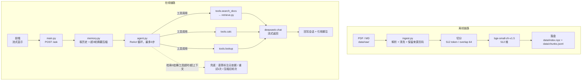

# agent-rag 架构

两条链路：离线入库（一次性、可重跑）与在线问答（每次提问走一遍）。

## 数据形态（每个箭头传什么）

| 环节 | 输入 | 输出 |
|---|---|---|
| ingest.py | 文件路径 | `str` 纯文本 + `dict` 元数据（source, page） |
| 切分 | 纯文本 | `list[dict]`，每项 `{text, source, page}` |
| 编码 | `list[str]` | `np.ndarray` N×512 float32，已 L2 归一化 |
| retrieve | 问题 `str` | `list[tuple[str, float]]`（文本块, 分数）top-k |
| agent | 问题 + 历史摘要 | `{"action": "tool"|"final", ...}` |
| 前端 | 流式 token | — |

## 状态存放位置（面试常问）

| 状态 | 存放 | 重启后 |
|---|---|---|
| 向量与原文块 | `data/index.npz` + `data/chunks.jsonl` | 保留（可重建） |
| 会话历史 | 进程内存 `dict[session_id] -> list` | **丢失**，已知取舍 |
| 长期用户偏好 | 不做（设计中） | — |

## 已知取舍（要能讲出来）

1. **不用向量数据库，用 numpy 暴力检索**：语料 <1000 块，全量余弦 <10ms，引入 Chroma/pgvector 是过度设计。
2. **会话记忆只在内存**：单机 demo 场景，重启丢历史可接受；上生产要落 Redis/Postgres。
3. **长期记忆不做**：需要额外的抽取、去重、召回设计，4 周内不划算，留作"设计中"。
4. **前端降级为 Streamlit / 单页 HTML**：不体现 AI 能力，时间投在 agent 与评测上。

## 失败路径（面试最爱问兜底）

| 场景 | 处理 |
|---|---|
| 检索 0 结果 | 不硬答，直说"文档里没找到依据"，并给出最接近的候选 |
| 工具报错 / 超时 | 错误信息作为工具结果回传模型，允许重试 1 次，再失败则收尾 |
| 超出上下文 | 对最旧轮次做摘要压缩，保留事实与结论，丢弃客套话 |
| 模型反复调同一工具 | 记已调用集合，第二次相同调用直接拦截并提示 |

## 我要能画出这张图的原因

面试问"你这个 Agent 怎么设计的"，答案就是这张图的第 4 个节点 + 工具分支 + 兜底表。
图里任何一个箭头说不出数据形态，就是没想清楚。
